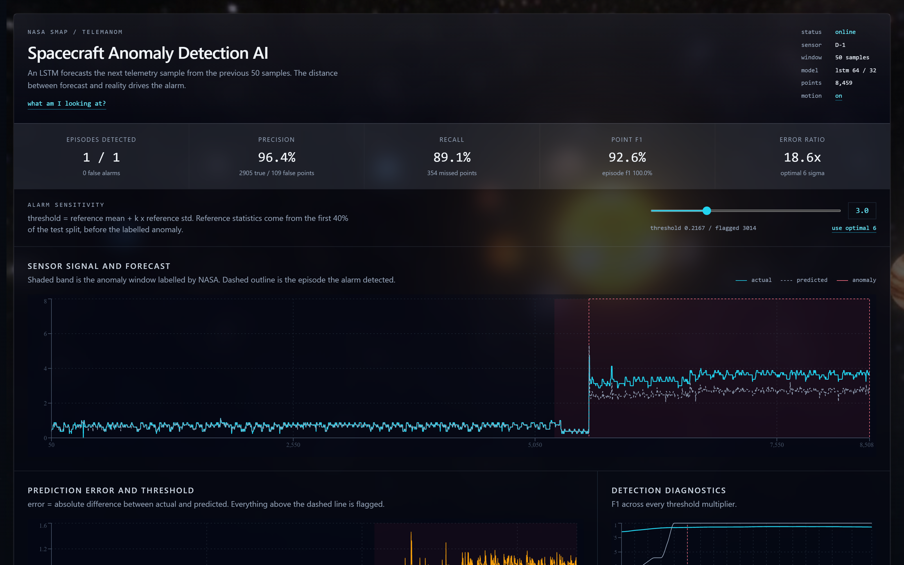
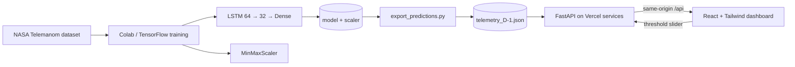

# Spacecraft Anomaly Detection AI

Full-stack anomaly detection for NASA spacecraft telemetry. An LSTM network is trained on
normal SMAP satellite behaviour, forecasts the next telemetry sample from a sliding window, and
flags deviations whose prediction error exceeds a tunable threshold. Predictions are served by a
FastAPI backend and explored through an interactive React mission-control dashboard.

**Live demo:** https://spacecraft-anomaly-detection-ai.vercel.app  
**API health:** https://nasa-anomaly-api.vercel.app/api/health



## Highlights

- **Real NASA telemetry**: Telemanom dataset (SMAP satellite, channel `D-1`) with anomaly
  windows labelled by NASA JPL engineers.
- **Principled model selection**: eight channels were screened with identical LSTM
  configurations before choosing `D-1` (see [benchmark](#channel-benchmark)).
- **Episode-level detection**: a persistence filter suppresses isolated spikes, so alarms are
  only raised for sustained deviations.
- **Tunable sensitivity**: the dashboard slider recomputes precision, recall and F1 live.
- **Zero-cost deployment**: the trained LSTM runs once during export, and FastAPI serves the
  forecasts on Vercel with gzip, shared caching and a same-origin `/api` route.
- **Optional 3D backdrop**: a Sketchfab solar-system scene, lazily embedded, dimmed behind the
  frosted console, with a motion toggle and a CSS starfield fallback.

## Results

| Metric | Value |
| ------ | ----- |
| Sensor | SMAP `D-1` |
| Forecast error ratio (anomaly / normal) | **19.2×** |
| Point precision / recall / F1 @ 3σ | 0.964 / 0.891 / **0.926** |
| Best point F1 (6σ) | **0.941** |
| Episode precision / recall / F1 @ 3σ | 1.000 / 1.000 / **1.000** |
| Training samples | 2,849 (2,799 windows) |
| Test samples | 8,509 (8,459 windows) |

## Dashboard

The React dashboard turns the raw forecast into a decision surface:

- **Alarm sensitivity slider**: moves the threshold between `1σ` and `8σ` and recomputes point
  precision / recall / F1 and episode recall instantly. A one-click button jumps to the
  empirically optimal multiplier (`6σ`, F1 `0.941`).
- **Signal vs forecast**: actual telemetry (cyan) against the LSTM forecast (grey dashed),
  with NASA-labelled windows shaded and detected episodes outlined.
- **Error chart**: the residual `|actual − predicted|` with the active threshold overlaid.
- **Diagnostics**: F1 across every sensitivity, plus reference statistics and detection
  configuration, so the trade-off between false alarms and missed anomalies is explicit.
- **Guided explainer**: the header opens a "What am I looking at?" dialog that explains the signal,
  the NASA anomaly band, the threshold formula and every metric in plain language.
- **Backdrop**: an optional Sketchfab solar-system scene sits behind the frosted console, with a
  motion toggle, reduced-motion support, lazy loading and a starfield fallback. The visual
  decisions are documented in [docs/DESIGN.md](docs/DESIGN.md).


## Architecture



## Dataset

The original `data.zip` bucket linked by the Telemanom paper now returns `403 Forbidden`, so the
project uses the public Hugging Face mirror `appleparan/telemanom`, which exposes per-channel
Parquet files (`timestep`, `value`, `cmd_*`). Ground-truth labels come from
`khundman/telemanom/labeled_anomalies.csv`.

| Split | Rows | Anomalies |
| ----- | ---- | --------- |
| train (`D-1`) | 2,849 | none (normal operation only) |
| test (`D-1`) | 8,509 | 1 window: `[5250, 8508]` |

### Channel benchmark

All channels were trained with the same architecture and scored with the best achievable
threshold on the normal reference segment.

| Sensor | Spacecraft | Error ratio | Best F1 | Decision |
| ------ | ---------- | ----------- | ------- | -------- |
| **D-1** | SMAP | 10.08× | **0.935** | selected |
| A-1 | SMAP | 24.45× | 0.404 | rejected (spiky, low recall) |
| E-1 | SMAP | 2.61× | 0.438 | rejected |
| E-2 | SMAP | 1.90× | 0.337 | rejected |
| S-1 | SMAP | 1.79× | 0.304 | rejected |
| T-1 | SMAP | 1.13× | 0.210 | rejected |
| F-1 | SMAP | 1.04× | 0.028 | rejected |
| P-1 | SMAP | 0.89× | 0.084 | rejected (contextual anomalies) |

`P-1`, the channel used in most tutorials, contains **contextual** anomalies: the raw value stays
inside its normal range and only its context is wrong. A forecasting model predicts it accurately,
so the error does not rise (ratio below 1). This was validated empirically, not assumed.

## Model

| Component | Choice |
| --------- | ------ |
| Input window | 50 samples |
| Layers | `LSTM(64, return_sequences=True)` → `Dropout(0.2)` → `LSTM(32)` → `Dropout(0.2)` → `Dense(1)` |
| Loss / optimiser | MSE / Adam |
| Regularisation | Dropout + `EarlyStopping(patience=5, restore_best_weights=True)` |
| Scaling | `MinMaxScaler` fitted on the training split only |
| Framework | TensorFlow 2.17.1 (CPU wheels), Keras 3 |
| Serving | Forecasts precomputed once, replayed by FastAPI (no TensorFlow at runtime) |

Training is reproducible with [`training/train.py`](training/train.py); the Colab notebook is
linked once uploaded.

## Detection logic

1. The LSTM predicts sample `t` from the previous 50 samples.
2. The residual is `error = |actual − predicted|`.
3. The threshold is `ref_mean + k · ref_std`, where the reference statistics come from the first
   40% of the test split (known normal behaviour), so the threshold is not contaminated by the
   anomaly itself.
4. A **persistence filter** keeps only runs of at least 3 consecutive flagged samples; shorter
   bursts are discarded as noise.
5. Consecutive flagged runs separated by fewer than 50 samples are merged into one alarm episode.
6. Metrics are reported both per point and per episode (an episode counts as detected when it
   overlaps a NASA-labelled window within a tolerance of 25 samples).

## API

| Method | Endpoint | Description |
| ------ | -------- | ----------- |
| GET | `/api/health` | Liveness, loaded model file, uptime |
| GET | `/api/model-info` | Sensor metadata, error statistics, channel benchmark |
| GET | `/api/telemetry/{sensor_id}` | Series of `step`, `actual`, `predicted`, `error`, `isTrueAnomaly` |
| GET | `/api/anomalies?sensitivity=3` | NASA windows, detected episodes, detection status |
| GET | `/api/metrics?sensitivity=3` | Precision / recall / F1 at point and episode level |
| GET | `/api/threshold-curve` | F1 as a function of the threshold multiplier |
| GET | `/api/benchmark` | Screening results across eight channels |

OpenAPI documentation: `http://localhost:8000/docs`.

## Project structure

```
.
├── backend/
│   ├── main.py                  # FastAPI application (no TensorFlow at runtime)
│   ├── telemetry_D-1.json       # precomputed forecasts + NASA anomaly labels
│   ├── requirements.txt
│   └── Dockerfile               # optional self-hosting image
├── frontend/
│   ├── src/App.jsx              # dashboard component
│   ├── src/index.css            # Tailwind entry point
│   ├── .env.production          # production API URL (public, not a secret)
│   ├── vercel.json              # CSP and security headers for the frontend project
│   ├── tailwind.config.js
│   └── vite.config.js
├── training/
│   ├── train.py                 # reproducible training script
│   ├── export_predictions.py    # writes backend/telemetry_D-1.json
│   ├── screen_channels.py       # channel benchmark
│   ├── artifacts/               # model, scaler and scaled test series
│   └── training_history.json
├── docs/
│   ├── dashboard.png            # rendered dashboard
│   ├── explainer.png            # "What am I looking at?" dialog
│   ├── DESIGN.md                # design decisions and anti-pattern notes
│   └── DEPLOYMENT.md            # Vercel two-project guide
├── SECURITY.md
├── vercel.json                  # optional services configuration (fallback)
└── README.md
```

## Quickstart

### Backend

```bash
cd backend
python -m venv .venv
# Windows: .venv\Scripts\activate
source .venv/bin/activate
pip install -r requirements.txt
uvicorn main:app --reload
```

Regenerate the precomputed forecasts (requires TensorFlow, training only):

```bash
pip install tensorflow==2.17.1 pandas pyarrow
python training/export_predictions.py
# wrote backend/telemetry_D-1.json (704 KB, 8459 points)
# anomaly_ratio=18.625 ref_mean=0.042356 ref_std=0.058108
# best point F1=0.9405 at sensitivity=6.00
```

### Frontend

```bash
cd frontend
npm install
npm run dev
```

## Security

The API is hardened for public hosting: CORS allow-list, trusted-host validation, per-IP rate
limiting, security headers, HSTS, disabled OpenAPI docs in production, generic error responses and
bounded input validation, gzip and shared caching. No secrets are committed, `.env` files are
ignored, and dependencies are audited (`npm audit` and `pip-audit` clean after removing
TensorFlow from the runtime). Rate limiting is per serverless instance, which is documented
honestly in the threat model.

The application has no accounts, database, cookies, uploads or write endpoints, so authentication,
RLS, CSRF, SQL-injection and password-hashing controls are intentionally out of scope. The full
threat model, verification evidence and production environment variables are documented in
[SECURITY.md](SECURITY.md).

## Deployment

Everything runs on **Vercel Hobby, at zero cost, without a payment method**, as two projects:

| Component | URL | Notes |
| --------- | --- | ----- |
| Frontend | https://spacecraft-anomaly-detection-ai.vercel.app | static Vite build, CSP and HSTS from `frontend/vercel.json` |
| Backend | https://nasa-anomaly-api.vercel.app | FastAPI + precomputed telemetry, gzip and shared caching |

The frontend reads `VITE_API_URL` from `frontend/.env.production` (a public URL, not a secret), so
the build is reproducible without dashboard settings. See
[docs/DEPLOYMENT.md](docs/DEPLOYMENT.md) for the import steps, free-tier limits and the optional
single-project services configuration.

## Credits

- Dataset: Hundman et al., *Detecting Spacecraft Anomalies Using LSTMs and Nonparametric Dynamic
  Thresholding* (KDD 2018), released via [telemanom](https://github.com/khundman/telemanom).
- Telemetry mirror: [`appleparan/telemanom`](https://huggingface.co/datasets/appleparan/telemanom).
- Data © NASA JPL, distributed under the Telemanom BSD-3-Clause licence.
- Backdrop: *Solar System* by pinotoon on Sketchfab, licensed Editorial and embedded with
  do-not-track. Replace it before any commercial use.
