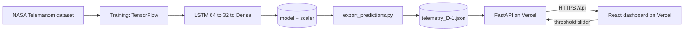
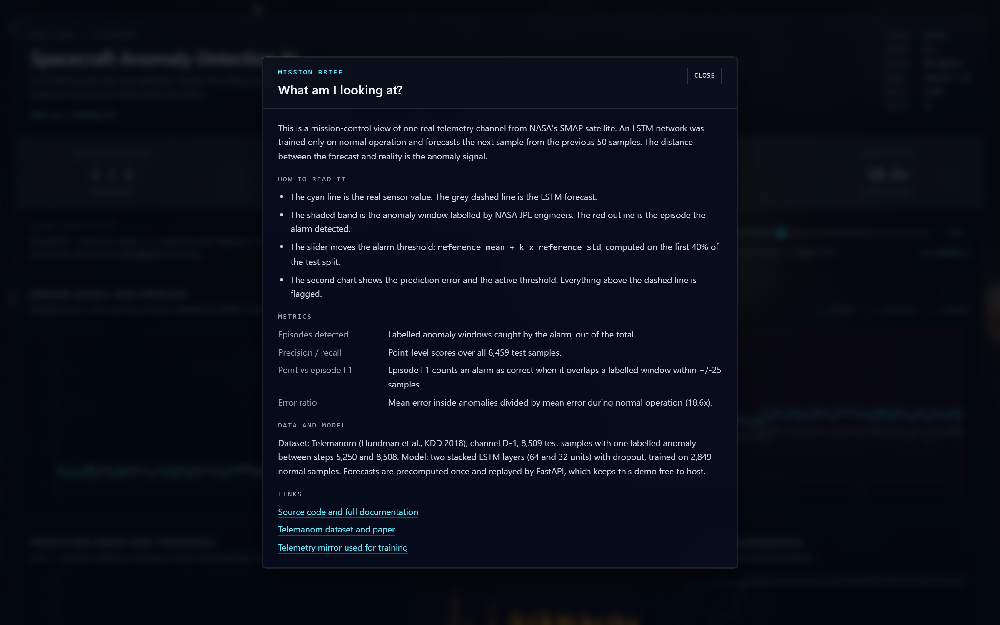
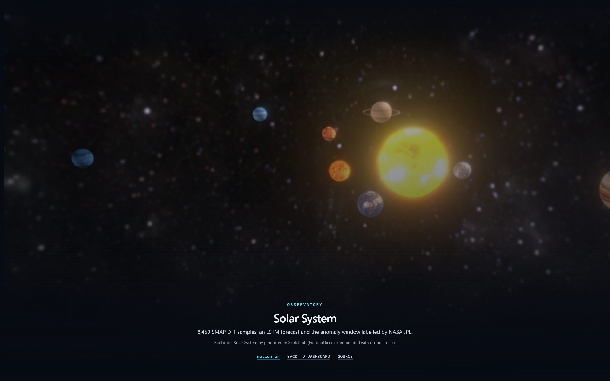

<div align="center">

# Spacecraft Anomaly Detection AI

**LSTM anomaly detection on real NASA SMAP telemetry, served by FastAPI and explored in a React
mission-control dashboard.**

[](https://spacecraft-anomaly-detection-ai.vercel.app)
[](https://nasa-anomaly-api.vercel.app/api/health)
[](https://github.com/ArditCeno/Spacecraft-Anomaly-Detection-AI/actions/workflows/ci.yml)
[](LICENSE)
[](docs/DEPLOYMENT.md)

[Live demo](https://spacecraft-anomaly-detection-ai.vercel.app) · [API health](https://nasa-anomaly-api.vercel.app/api/health) · [Deployment guide](docs/DEPLOYMENT.md) · [Security](SECURITY.md) · [Design notes](docs/DESIGN.md)

</div>


## What this is

A complete anomaly-detection system built on a public NASA dataset:

- **Train on normal behaviour only.** A two-layer LSTM learns how the SMAP `D-1` sensor behaves
  during fault-free operation.
- **Forecast, then measure.** It predicts the next sample from the previous 50 samples. The residual
  `|actual - predicted|` is the anomaly signal.
- **Tune the alarm live.** The dashboard slider moves the threshold from `1σ` to `8σ` and recomputes
  precision, recall and F1 instantly.
- **Ship it for free.** Precomputed forecasts keep the FastAPI runtime small enough for Vercel
  Hobby at **$0, without a payment method**.

| Metric | Value |
| ------ | ----- |
| Sensor | SMAP `D-1` (8,509 test samples) |
| Forecast error ratio (anomaly / normal) | **18.6×** |
| Point precision / recall / F1 @ 3σ | 0.964 / 0.891 / **0.926** |
| Best point F1 @ 6σ | **0.941** |
| Episode precision / recall / F1 @ 3σ | 1.000 / 1.000 / **1.000** |
| Persistence baseline (best F1) | 0.153 |
| Runtime dependencies | FastAPI, NumPy, Uvicorn |

## Table of contents

- [Architecture](#architecture)
- [Dataset](#dataset)
- [Channel benchmark](#channel-benchmark)
- [Model](#model)
- [Detection logic](#detection-logic)
- [Results](#results)
- [Baseline and limitations](#baseline-and-limitations)
- [API](#api)
- [Dashboard](#dashboard)
- [Security](#security)
- [Deployment](#deployment)
- [Reproduce](#reproduce)
- [Project structure](#project-structure)
- [License](#license)
- [Credits](#credits)

## Architecture



The trained network runs once during export. The API replays its forecasts, which makes responses
deterministic, start-up fast and the deployment small enough for free serverless hosting.

## Dataset

[Telemanom](https://github.com/khundman/telemanom) (Hundman et al., KDD 2018), channel `D-1` from
the SMAP satellite. Labels were produced by NASA JPL engineers.

The original S3 bucket linked in the paper now returns `403 Forbidden`, so this project uses the
public Hugging Face mirror [`appleparan/telemanom`](https://huggingface.co/datasets/appleparan/telemanom).

| Split | Rows | Anomalies | Use |
| ----- | ---- | --------- | --- |
| train (`D-1`) | 2,849 | none | Fit the scaler and train on normal operation |
| test (`D-1`) | 8,509 | 1 window: `[5250, 8508]` | Evaluation and dashboard |

Validation performed before training:

- Test length matches the NASA `num_values` field.
- Anomaly indices match `labeled_anomalies.csv`.
- No missing values; values stay inside the original `[-1, 1]` range.
- The scaler is fitted on the training split only.

### Channel benchmark

Eight channels were screened with the same architecture. The criterion was forecast-error
separability plus the best achievable F1 over a threshold grid.

| Sensor | Spacecraft | Error ratio | Best F1 | Decision |
| ------ | ---------- | ----------- | ------- | -------- |
| **D-1** | SMAP | 10.08× | **0.935** | selected |
| A-1 | SMAP | 24.45× | 0.404 | rejected (spiky, low recall) |
| E-1 | SMAP | 2.61× | 0.438 | rejected |
| E-2 | SMAP | 1.90× | 0.337 | rejected |
| S-1 | SMAP | 1.79× | 0.304 | rejected |
| T-1 | SMAP | 1.13× | 0.210 | rejected |
| F-1 | SMAP | 1.04× | 0.028 | rejected |
| P-1 | SMAP | 0.89× | 0.084 | rejected (contextual anomalies) |

`P-1`, the channel used in most tutorials, contains **contextual** anomalies: the value stays
inside its normal range and only its context is wrong. A forecasting model predicts it accurately,
so the error does not rise. This was validated empirically, not assumed.

## Model

| Component | Choice |
| --------- | ------ |
| Input window | 50 samples |
| Layers | `LSTM(64, return_sequences=True)` → `Dropout(0.2)` → `LSTM(32)` → `Dropout(0.2)` → `Dense(1)` |
| Loss / optimiser | MSE / Adam |
| Regularisation | Dropout + `EarlyStopping(patience=5, restore_best_weights=True)` |
| Training | Up to 60 epochs, batch 64, 10% validation split |
| Framework | TensorFlow 2.17.1 (CPU), Keras 3 |
| Serving | Precomputed forecasts replayed by FastAPI (no TensorFlow at runtime) |

Training and export are reproducible with `training/train.py` and `training/export_predictions.py`.

## Detection logic

1. Predict sample `t` from the previous 50 samples.
2. Compute `error = |actual - predicted|`.
3. Build the threshold as `ref_mean + k · ref_std`, using the first 40% of the test split (known
   normal behaviour) as the reference.
4. Apply a persistence filter: only runs of at least 3 consecutive flagged samples are kept.
5. Merge flagged runs separated by fewer than 50 samples into one alarm episode.
6. Score both points and episodes. An episode counts as detected when it overlaps a NASA window
   within a tolerance of 25 samples.

## Results

| k | Threshold | Precision | Recall | F1 |
| - | --------- | --------- | ------ | -- |
| 1.0 | 0.1005 | 0.852 | 0.899 | 0.875 |
| 2.0 | 0.1586 | 0.943 | 0.892 | 0.917 |
| 2.5 | 0.1876 | 0.958 | 0.892 | 0.924 |
| **3.0** | **0.2167** | **0.964** | **0.891** | **0.926** |
| 4.0 | 0.2748 | 0.980 | 0.891 | 0.933 |
| **6.0** | **0.3910** | **0.997** | **0.891** | **0.941** |
| 8.0 | 0.5072 | 0.999 | 0.887 | 0.940 |

Recall plateaus around 0.89 because the first ~350 anomaly samples still look predictable: the
model keeps forecasting the previous behaviour until the deviation becomes clear. That is expected
for a long, sustained anomaly, not a bug.

## Baseline and limitations

A naive persistence forecast (predict the previous sample), tuned over the same threshold grid,
reaches a best point F1 of **0.153** (precision 0.317, recall 0.101). The LSTM reaches **0.941**, so
the result is not an artefact of threshold tuning.

Honest limitations:

- The channel (`D-1`) and the optimal multiplier (`6σ`) were selected using test-set performance.
  The numbers are optimistic for a demo; a stricter protocol would choose both on a separate
  validation split.
- The test split contains a single labelled anomaly episode, so episode F1 of 1.0 is encouraging
  but not statistically strong.
- Only 2,849 normal samples are available for training, and adjacent sliding windows overlap by one
  window at the validation boundary.
- The telemetry mirror is a third-party copy of the original Telemanom release. Counts and labels
  were validated; values were not diffed byte-for-byte against a second mirror.
- Inference is precomputed. Hosting stays free and deterministic, but the API does not run
  TensorFlow per request.
- Rate limiting runs in memory per serverless instance. It is a demo control, not a distributed
  quota.

## API

Base URL: `https://nasa-anomaly-api.vercel.app`

| Method | Endpoint | Description |
| ------ | -------- | ----------- |
| GET | `/api/health` | Liveness, inference mode and uptime |
| GET | `/api/model-info` | Sensor metadata, error statistics and benchmark |
| GET | `/api/telemetry/{sensor_id}` | `step`, `actual`, `predicted`, `error`, `isTrueAnomaly` |
| GET | `/api/anomalies?sensitivity=3` | NASA windows and detected episodes |
| GET | `/api/metrics?sensitivity=3` | Point and episode precision / recall / F1 |
| GET | `/api/threshold-curve` | F1 as a function of the threshold multiplier |
| GET | `/api/benchmark` | Screening results across eight channels |

Operational details:

- Responses are gzip-compressed: the full telemetry payload shrinks from 720,945 to 63,925 bytes.
- Telemetry and metrics carry `Cache-Control: public, s-maxage=300, stale-while-revalidate=600`.
- OpenAPI docs are disabled in production (`/docs` returns `404`).
- Nine contract tests cover the endpoints, metric values and security headers (`backend/tests`).

## Dashboard



- **Alarm sensitivity slider**: moves the threshold between `1σ` and `8σ` and recomputes point
  precision / recall / F1 and episode recall instantly. One click jumps to the optimal multiplier
  (`6σ`, F1 `0.941`).
- **Signal vs forecast**: actual telemetry (cyan) against the LSTM forecast (grey dashed), with the
  NASA window shaded and the detected episode outlined.
- **Error chart**: the residual with the active threshold overlaid.
- **Diagnostics**: F1 across every sensitivity plus reference statistics and detection settings.
- **Guided explainer**: a frosted "What am I looking at?" dialog explains the signal, anomaly band,
  threshold formula and every metric.
- **Observatory**: a full-screen section below the dashboard where the glass panels end and only the
  solar-system backdrop, data provenance and motion control remain.
- **Backdrop**: an optional Sketchfab solar-system scene behind a frosted console, with a motion
  toggle, reduced-motion support, lazy loading and a starfield fallback.



*A full-viewport section below the dashboard: only the solar-system backdrop, provenance and
controls remain.*

Visual decisions are documented in [docs/DESIGN.md](docs/DESIGN.md).

## Security

The API is hardened for public hosting: CORS allow-list, trusted-host validation, per-IP rate
limiting, security headers, HSTS, gzip, shared caching, disabled OpenAPI docs in production, generic
error responses and bounded input validation. No secrets are committed, `.env` files are ignored,
and dependencies are audited in CI (`npm audit` and `pip-audit`, both clean).

The application has no accounts, database, cookies, uploads or write endpoints, so authentication,
RLS, CSRF, SQL injection and password hashing controls are intentionally out of scope. The full
threat model and environment variables are documented in [SECURITY.md](SECURITY.md).

## Deployment

Everything runs on **Vercel Hobby, at zero cost, without a payment method**, as two projects:

| Component | URL | Notes |
| --------- | --- | ----- |
| Frontend | https://spacecraft-anomaly-detection-ai.vercel.app | Vite build, CSP and HSTS from `frontend/vercel.json` |
| Backend | https://nasa-anomaly-api.vercel.app | FastAPI + precomputed telemetry, gzip and shared caching |

The frontend reads `VITE_API_URL` from `frontend/.env.production` (a public URL, not a secret), so
builds are reproducible without dashboard settings. Full instructions, free-tier limits and the
services alternative are in [docs/DEPLOYMENT.md](docs/DEPLOYMENT.md).

## Reproduce

```bash
# 1. Train and export (TensorFlow is only needed here)
pip install tensorflow==2.17.1 pandas pyarrow scikit-learn joblib
python training/train.py --sensor D-1
python training/export_predictions.py

# 2. Backend
cd backend
python -m venv .venv
# Windows: .venv\Scripts\activate
source .venv/bin/activate
pip install -r requirements.txt -r requirements-dev.txt
uvicorn main:app --reload
pytest tests -q          # 9 contract tests

# 3. Frontend
cd ../frontend
npm install
npm run dev              # Vite proxies /api to 127.0.0.1:8000
```

The exported artefact is reported by the script:

```text
wrote backend/telemetry_D-1.json (704 KB, 8459 points)
anomaly_ratio=18.625 ref_mean=0.042356 ref_std=0.058108
best point F1=0.9405 at sensitivity=6.00
```

## Project structure

```text
.
├── backend/
│   ├── main.py                  # FastAPI application, no TensorFlow at runtime
│   ├── config.py                # environment-driven settings
│   ├── security.py              # headers, cache and rate limiting middleware
│   ├── telemetry_D-1.json       # precomputed forecasts and NASA labels
│   ├── requirements.txt         # runtime dependencies
│   ├── requirements-dev.txt     # pytest and httpx
│   ├── tests/test_api.py        # 9 API contract tests
│   └── Dockerfile               # optional self-hosting image
├── frontend/
│   ├── src/App.jsx              # dashboard, explainer and backdrop
│   ├── src/index.css            # Tailwind entry point
│   ├── .env.production          # production API URL (public)
│   ├── vercel.json              # CSP and security headers
│   └── package.json
├── training/
│   ├── train.py                 # reproducible training
│   ├── export_predictions.py    # writes backend/telemetry_D-1.json
│   ├── screen_channels.py       # eight-channel benchmark
│   ├── artifacts/               # model, scaler and scaled test series
│   └── training_history.json
├── docs/
│   ├── dashboard.png
│   ├── explainer.png
│   ├── observatory.png
│   ├── DESIGN.md
│   └── DEPLOYMENT.md
├── .github/workflows/ci.yml     # build, tests and dependency audits
├── LICENSE                      # MIT for the code
├── NOTICE.md                    # third-party attributions
├── SECURITY.md
├── vercel.json                  # optional services configuration
└── README.md
```

## License

- **Code:** MIT, © 2026 Ardit Ceno. See [LICENSE](LICENSE).
- **Telemetry data:** NASA SMAP, distributed with Telemanom under the **BSD-3-Clause** license.
  Anomaly labels by NASA JPL. See [NOTICE.md](NOTICE.md).
- **3D backdrop:** *Solar System* by pinotoon on Sketchfab, **Editorial** license, embedded with
  attribution and `dnt=1`. Replace it before any commercial use.
- **Dependencies:** each package keeps its own license; see `backend/requirements.txt`,
  `backend/requirements-dev.txt` and `frontend/package.json`.

## Credits

- Dataset: Hundman, Constantinou, Laporte, Colwell and Soderstrom, *Detecting Spacecraft Anomalies
  Using LSTMs and Nonparametric Dynamic Thresholding* (KDD 2018), released via
  [telemanom](https://github.com/khundman/telemanom).
- Telemetry mirror: [`appleparan/telemanom`](https://huggingface.co/datasets/appleparan/telemanom).
- Backdrop: [Solar System by pinotoon](https://sketchfab.com/3d-models/solar-system-178d1deb210a4bc4a63ee05bc6cb6dcf).

<div align="center">
<sub>Built with TensorFlow, FastAPI, React and a lot of attention to detail.</sub>
</div>
